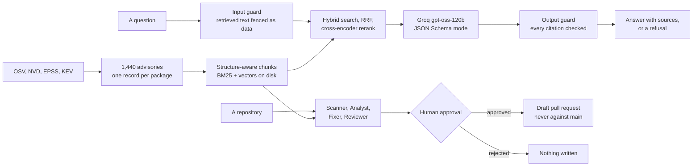

# Security Copilot

[](https://github.com/SURYAPRASATHJP/Security-Copilot/actions/workflows/tests.yml)
[](https://github.com/SURYAPRASATHJP/Security-Copilot/actions/workflows/evals.yml)

Tells you whether your Python dependencies have known vulnerabilities, explains each one
with a cited advisory, and opens a pull request that fixes it.

Version ranges are decided by code, never by the model. The model explains what an advisory
means; the `packaging` library decides whether your pinned version is inside the affected
range. Getting that boundary wrong is the usual way a tool like this starts inventing
answers.

A real pull request it opened: [vulnerable-demo-app#1](https://github.com/SURYAPRASATHJP/vulnerable-demo-app/pull/1).

## How it works



Whether a pinned version falls inside an affected range is decided by the `packaging`
library, not the model. Nothing is written to a file or a branch without a person saying yes.
Both diagrams in full, question and repository, are in
[docs/architecture.md](docs/architecture.md).

## Results

| What | Number |
| --- | --- |
| Retrieval hit rate at 5 | 0.995 |
| Retrieval MRR | 0.976 |
| Hit rate with fixed-size chunks instead | 0.520 |
| Answer accuracy | 1.000 (30 of 30) |
| Refusal accuracy on invented CVEs | 1.000 (20 of 20) |
| Attack block rate, with guardrails | 96.88% of 64, against 37.50% without them |
| Agent scenarios passed | 10 of 10 |
| Writes without a human approval | 0 |
| Prompt injection classifier F1 | 0.969 |
| Prompt injection classifier recall | 0.975 |
| Cost per answered question | $0.00033 |
| Cost per repository scan | $0.00023 |
| p95 latency under 20 concurrent users | 0.470 s |
| Advisories in the corpus | 1,440 over 102 packages |

Every number comes from `make evals` and is written to
[docs/eval_report.md](docs/eval_report.md), which also says what each one does not measure.

## Status

Complete, and measured. Every number in this README comes from `make evals` and is written
to [docs/eval_report.md](docs/eval_report.md), including the model-graded ones: the rubric
judge, RAGAS as a second opinion, the three-model comparison and the full red team set.

**It runs locally rather than on a hosted demo.** Hugging Face now requires a paid plan to
create a Docker Space, and this project is built to stay at zero cost, so there is no public
URL to click. [Run it](#run-it) takes two commands once the index is built, and the reasoning
is recorded in [docs/decisions.md](docs/decisions.md).

## How it is laid out

| Document | What it holds |
| --- | --- |
| [docs/architecture.md](docs/architecture.md) | How a question and a repository each flow through the system |
| [docs/decisions.md](docs/decisions.md) | 27 design decisions, the options compared, the evidence |
| [docs/eval_report.md](docs/eval_report.md) | Every measurement, and what each does not measure |
| [docs/model_card.md](docs/model_card.md) | The prompt injection classifier, its data and its weaknesses |
| [docs/responsible_ai.md](docs/responsible_ai.md) | Risks, licences, what is logged, EU AI Act position |
| [docs/red_team_report.md](docs/red_team_report.md) | 64 OWASP-tagged attacks and what got through |
| [docs/use_with_mcp_clients.md](docs/use_with_mcp_clients.md) | Using the seven tools from your own editor |

## Run it

```sh
cp .env.example .env     # then paste your key from console.groq.com after GROQ_API_KEY=
make setup               # install every dependency group into .venv
make data                # download OSV, NVD, EPSS and KEV, then merge them
make index               # chunk and build the vector and keyword indexes
make api                 # serve the backend on http://127.0.0.1:8000
make app                 # serve the interface in another terminal
```

`make help` lists every target. `make test` and `make lint` need no key and no data.

## Phase 1 results

Measured by `make evals` on 200 generated retrieval questions and 50 answer questions.
The golden set is generated from the advisory corpus itself, so every answer is known
without anyone labelling it.

| What | Number |
| --- | --- |
| Advisories in the corpus | 1,440 across 102 of the 300 most-downloaded PyPI packages |
| With a CVSS score / EPSS probability | 95.3% / 95.4% |
| On the CISA Known Exploited list | 10 |
| Hit rate at 5, shipped setup | 0.995 |
| MRR, shipped setup | 0.976 |
| Hit rate at 5, fixed-size chunks | 0.520 |
| Answer accuracy | 1.000 (30 of 30) |
| Refusal accuracy on invented CVEs | 1.000 (20 of 20) |
| Invented citations | 0 of 50 answers |
| Cost per answer | $0.00043, about 5 seconds |

### What chunking did

Giving every chunk a one-line context header and a self-contained summary card mattered
far more than the choice of retriever. The same BM25 index went from 0.515 to 1.000 hit
rate at 5 on nothing but the chunk shape.

| Retriever | Fixed-size chunks | Structure-aware chunks |
| --- | --- | --- |
| BM25 | 0.515 | 1.000 |
| Vector | 0.260 | 0.435 |
| Hybrid | 0.515 | 1.000 |
| Hybrid plus rerank | 0.520 | 0.995 |

Read those hit rates with care. Every generated question quotes its advisory or CVE id,
which is exactly what BM25 is best at, so its score flatters it. MRR is the honest
separator: hybrid plus rerank reaches 0.976 against BM25's 0.940, and it is the only
setup that holds up when the question does not quote an id. Full numbers and the
caveat are in [docs/eval_report.md](docs/eval_report.md).

### On the demo app

`demo_vulnerable_app/` pins eight packages to deliberately old versions. The check finds
50 distinct findings across all eight, ordered by what to fix first: on the CISA known
exploited list, then exploit probability, then severity. Advisories that mirror the same
CVE are collapsed, which took the raw count from 93 down to 50.

## Phase 2 results

Seven tools are served over MCP, so the agent and any MCP-speaking editor use the same
definitions and the same refusals. See [docs/use_with_mcp_clients.md](docs/use_with_mcp_clients.md).

| What | Number |
| --- | --- |
| Tools served over MCP | 7, of which 2 can write |
| Scenarios the team passed | 10 of 10 |
| Scenarios the single ReAct agent passed | 4 of 10, for 227,464 tokens |
| Writes without an approval | 0 |
| Model tokens the team spent on those scenarios | 0 |
| Steps per scan | 4 |

On the demo app the team ranks `cryptography`, `requests` and `flask` above `werkzeug`,
`urllib3` and `idna`, because the first three are imported and called and the last three
only arrive as transitive dependencies. `werkzeug` has the highest exploit probability of
the eight and still ranks fourth, which is the whole point of checking usage with `ast`
before ranking.

The single ReAct agent baseline has not run yet. Groq's free tier allows 200,000 tokens a
day and the answer evals spent it, so the comparison is deferred rather than guessed at.
[docs/eval_report.md](docs/eval_report.md) says so in full.

### Nothing is written without a person

The graph stops at an approval node, writes its state to SQLite, and shows the diff. A
rejection writes nothing, an edit writes only the lines that were ticked, and the writer
refuses to act on anything other than an approval. That path has its own tests in
`tests/test_team_write_path.py`.

## How it is put together

| Piece | Where | What it does |
| --- | --- | --- |
| Settings | `src/copilot/settings.py` | Model name, prices, paths and keys, read from `.env` |
| LLM client | `src/copilot/llm_client.py` | Groq through the `openai` SDK, backoff on 429 and 5xx, a disk cache, JSON Schema mode, a cost log |
| Data collection | `src/copilot/data_collection/` | OSV, NVD, EPSS and KEV, merged into one record per advisory and package |
| Retrieval | `src/copilot/rag/` | Two chunking strategies, BM25, vectors, reciprocal rank fusion, cross-encoder reranking |
| Dependency check | `src/copilot/dependencies/` | Requirements parsing and the version comparison, with no model involved |
| Tools | `src/copilot/agents/tools/` | Seven tools, Pydantic in and out, read and write separated |
| Agents | `src/copilot/agents/` | The MCP server, the triage agent, the team graph, memory, approval |
| Evaluation | `src/copilot/evals/` | The generated golden set and every measurement above |
| Decisions | `docs/decisions.md` | Every design choice, the options compared, and the evidence |

Keys live only in `.env`, which is ignored by git from the first commit. Nothing is
printed or logged.

## Data sources

OSV, the NVD CVE API, FIRST EPSS and the CISA Known Exploited Vulnerabilities catalogue.
All public, no key required.
