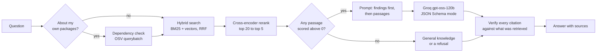
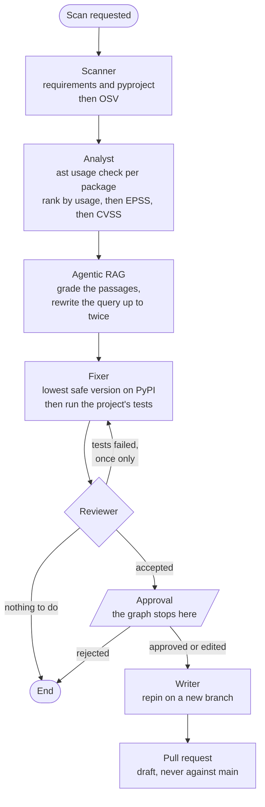

# How it is put together

Two things run: a retrieval pipeline that answers questions about advisories, and an agent
team that acts on a repository. They share one rule, which is the whole design: **the model
explains, the code decides**. Every version comparison, every range check and every
ranking is ordinary Python. The model is used where judgement is genuinely needed and
nowhere else.

## A question becomes an answer

The verification step at the end is what makes the citations trustworthy: an id the model
produces that was not in the retrieved set is stripped out and reported separately, so an
invented reference can never reach the reader looking like a real one.

## A repository becomes a pull request

The Approval node is a LangGraph interrupt. The graph genuinely stops: its state is written
to SQLite, the planned diff goes to whoever is watching, and nothing resumes until a
decision comes back. A rejection raises rather than falling through, and an edit writes only
the subset that was ticked.

## Where each piece lives

| Layer | Files | Notes |
| --- | --- | --- |
| Data | `src/copilot/data_collection/` | OSV, NVD, EPSS and KEV merged into one record per advisory and package |
| Retrieval | `src/copilot/rag/` | Two chunking strategies, BM25, Chroma, reciprocal rank fusion, cross-encoder |
| Version logic | `src/copilot/dependencies/` | Requirements parsing and range comparison, with no model involved |
| Tools | `src/copilot/agents/tools/` | Seven tools, Pydantic in and out, read and write clearly separated |
| Tool server | `src/copilot/agents/mcp_tool_server.py` | The same seven over MCP, for the agent and for any editor |
| Agents | `src/copilot/agents/` | One triage agent, and the team graph above |
| Interfaces | `api/`, `app/` | FastAPI, with Streamlit calling it over HTTP |

## Why the agent talks to its own tool server

The agent could import the tool functions directly. It loads them over MCP instead, which
costs a subprocess and a little latency. What that buys is one definition of what a tool
does and what it refuses: the guard that stops `update_the_requirements_file` touching
anything but a `requirements*.txt` protects the agent and your editor in the same line of
code, and the descriptions the model reads to choose a tool are the same ones a person
reads in `docs/use_with_mcp_clients.md`.

## What the free tier forces

Groq's free tier allows 200,000 tokens a day. That is not a footnote, it is a design
constraint. It is why every LLM reply is cached on disk, why the lookup tool returns the
worst ten findings rather than all fifty, why an agent run stops at 60,000 tokens or twelve
steps, and why the ranking is computed in Python rather than asked for. The cheapest
request is the one never sent.
